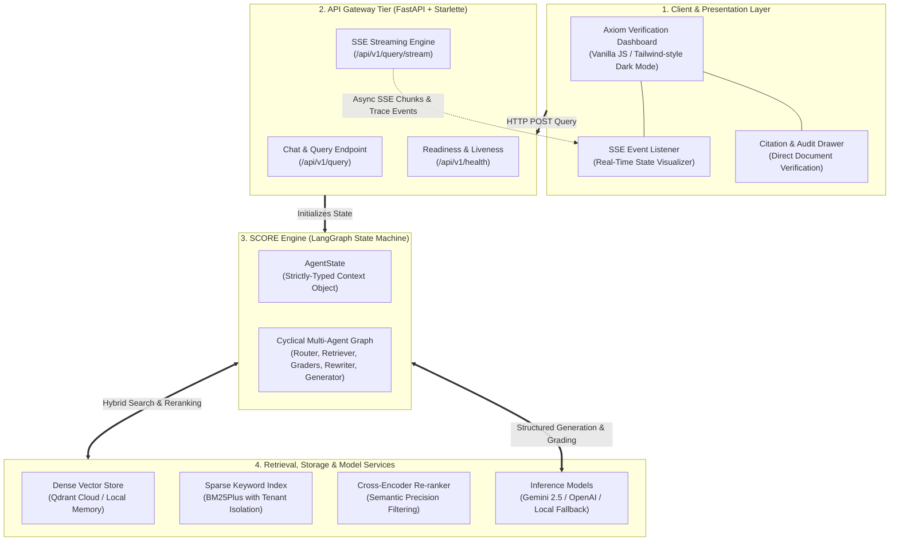
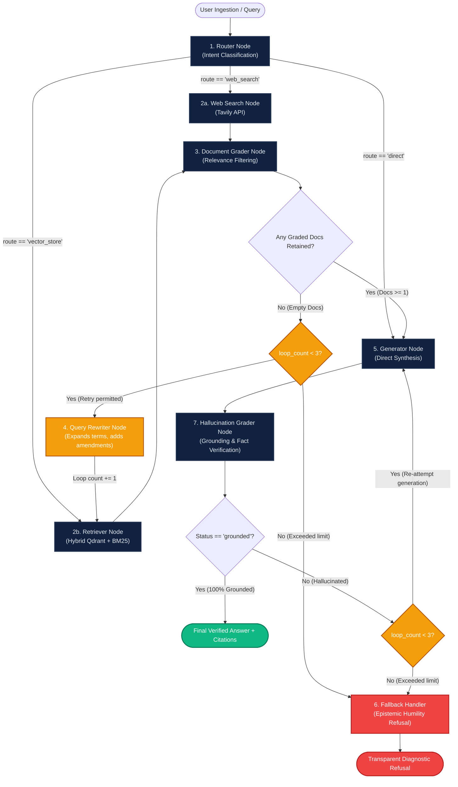
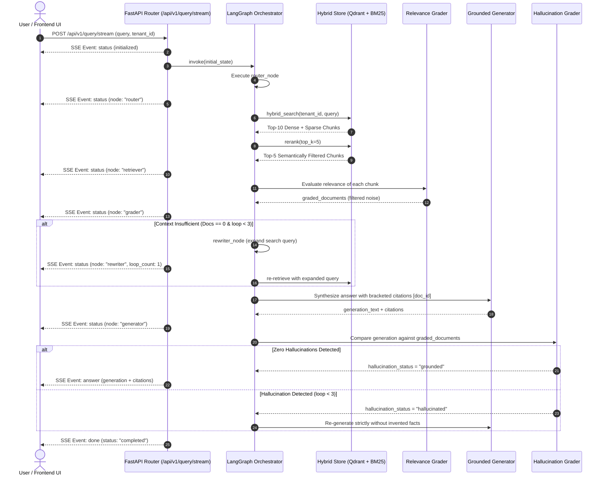
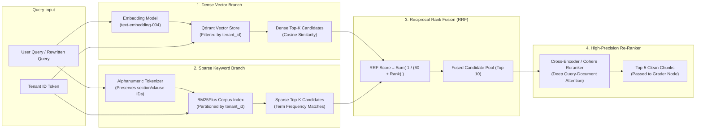

# ⚡ Axiom & SCORE Engine: Complete System Visual Flow

> Visual reference guide for the **Axiom** architecture, execution lifecycle, dual self-correction loops, and multi-tenant hybrid retrieval pipeline.

---

## 1. High-Level System Architecture Topology

The entire system is composed of four decoupled operational tiers: **Client Layer**, **API Gateway & Streaming Tier**, **SCORE Cyclical State Machine**, and **Multi-Tenant Data & Model Tier**.



---

## 2. The 9-Node SCORE State Machine (Detailed Execution Flow)

At the heart of Axiom is the cyclical state machine implemented in [`src/axiom/core/graph.py`](file:///e:/AXIOM/src/axiom/core/graph.py). It continuously audits both retrieved inputs and generated outputs:



---

## 3. End-to-End Query Lifecycle (Sequence Diagram)

This diagram details the request-response cycle and async Server-Sent Event (SSE) updates as a query moves across components:



---

## 4. Multi-Tenant Hybrid Retrieval Pipeline

The retrieval tier guarantees tenant data isolation while combining vector similarity with exact term matching:



---

## 5. Visualizing How Axiom Solves the 4 Enterprise RAG Failures

```
+----------------------------------------------------------------------------------------------------+
| 1. THE AMENDMENT TRAP                                                                              |
| Standard RAG: Finds 2022 MSA ($1M liability cap) -> Outputs legally void terms.                   |
| Axiom SCORE:  Doc Grader flags missing active terms -> Query Rewriter searches for 'Addendum'     |
|               -> Retrieves 2024 Addendum No. 3 ($2.5M cap) -> Verifies superseding clause.         |
+----------------------------------------------------------------------------------------------------+
| 2. THE MULTI-HOP DISCONNECT                                                                        |
| Standard RAG: Section 2.4 says 'governed by Appendix IV' -> Answers without seeing Appendix IV.    |
| Axiom SCORE:  Doc Grader checks clause completeness -> Rewriter retrieves Appendix IV on page 88   |
|               -> Synthesizes mandatory 3-year cliff vesting terms.                                 |
+----------------------------------------------------------------------------------------------------+
| 3. TABULAR FOOTNOTE DISTORTION                                                                     |
| Standard RAG: Reads Financial Table ($450M operating income) -> Misses restructuring note.         |
| Axiom SCORE:  Table Preserving Parser connects Markdown table with Footnote 14b                    |
|               -> Explains $120M one-off divestiture; reveals $330M recurring operational income.   |
+----------------------------------------------------------------------------------------------------+
| 4. THE SILENT BLUFF (Zero-Hallucination)                                                           |
| Standard RAG: Query asks for unsupported cloud region -> LLM invents plausible fake SLA numbers.   |
| Axiom SCORE:  Context missing verified SLA -> Loop counter exhausts -> Fallback Handler triggers   |
|               -> Returns honest refusal with exact search audit trail. Never bluffs.               |
+----------------------------------------------------------------------------------------------------+
```

---

## 6. AgentState Transformation Across Nodes

| Node Name | Inputs Read from State | Outputs Written / Appended to State |
| :--- | :--- | :--- |
| [`router`](file:///e:/AXIOM/src/axiom/core/nodes/router.py) | `query` | `route` ("vector_store" \| "web_search" \| "direct"), `reasoning_trace` |
| [`retriever`](file:///e:/AXIOM/src/axiom/core/nodes/retriever.py) | `query`, `rewritten_query`, `route`, `tenant_id` | `documents` (List[DocumentChunk]), `reasoning_trace` |
| [`grader`](file:///e:/AXIOM/src/axiom/core/nodes/grader.py) | `query`, `documents` | `graded_documents` (retained relevant chunks), `reasoning_trace` |
| [`rewriter`](file:///e:/AXIOM/src/axiom/core/nodes/rewriter.py) | `query`, `loop_count`, `rewritten_query` | `rewritten_query`, `loop_count` (+1), `reasoning_trace` |
| [`generator`](file:///e:/AXIOM/src/axiom/core/nodes/generator.py) | `query`, `graded_documents` | `generation` (answer text), `citations` (List[Citation]), `reasoning_trace` |
| [`hallucination_grader`](file:///e:/AXIOM/src/axiom/core/nodes/hallucination_grader.py) | `generation`, `graded_documents` | `hallucination_status` ("grounded" \| "hallucinated"), `reasoning_trace` |
| [`fallback`](file:///e:/AXIOM/src/axiom/core/nodes/fallback.py) | `query`, `loop_count`, `rewritten_query` | `generation` (diagnostic refusal), `fallback_reason`, `hallucination_status` = "grounded", `reasoning_trace` |
